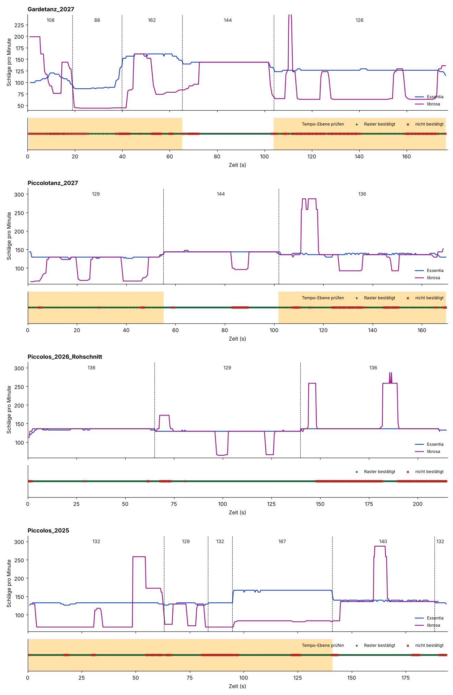

# Spike M0.1: Schlagerkennung auf echter Vereinsmusik

**Stand:** 19.11.2026 · **Risiko:** Konzept, Abschnitt 10, Nr. 1 („Schlagerkennung versagt bei Garde-Medleys mit Tempowechseln“)
**Musik:** 4 Tänze des Vereins (Gardetanz 2027, Piccolotanz 2027, Piccolos 2026 Rohschnitt, Piccolos 2025). Die Musik liegt **nicht** im Repository.

## Kurz gesagt

- **Tempowechsel werden zuverlässig gefunden.** Essentia erkennt in allen vier Medleys die Abschnitte und hält das Tempo darin fast perfekt gleichmäßig (Schwankung 0–12 ms, das ist die Messauflösung).
- **Unsicher ist die Tempo-Ebene.** Oft ist nicht klar, ob auf jeden Schlag oder auf jeden zweiten gezählt wird (z. B. 167 oder 83 Schläge/min). Das kann nur der Trainer entscheiden, und die App muss es mit **einem Tipp pro Abschnitt** korrigierbar machen.
- **Manchmal liegt das Raster auf dem Gegenschlag** (bei Märschen mit „Umpa“-Begleitung). Auch das braucht eine Ein-Tipp-Korrektur.
- **Die „1“ (Taktanfang) ist automatisch nicht verlässlich.** Der Trainer setzt „Bild 1 beginnt hier“ ohnehin selbst. Von dort zählt die App.
- **Freie Intros** (Gardetanz 2027, erste ~19 s) haben kein festes Tempo und brauchen kein Raster. Bild 1 beginnt danach.
- **Hörtest Gardetanz 2027 (schwierigste Musik):** Die erkannten Abschnitte entsprechen den gehörten Musikteilen (die Zeitangaben des Trainers sind grob). Nur ein Abschnitt (Viva Colonia) ist doppelt so schnell erkannt. **Mit einem Tipp „halb so schnell“ stimmt das Raster im ganzen Tanz.** Ohne Korrektur liegen 92 % der Klicks auf gezählten Schritten.
- **Hörtest Piccolotanz 2027:** passt komplett, **keine Korrektur** nötig (außer „Bild 1 beginnt hier“).
- **Piccolos 2026 und 2025** sind noch im Hörtest. Vorhersagen dafür stehen unten.

## Vorgehen

Zwei unabhängige Verfahren, ohne Modell-Download:

| Verfahren | Rolle im Spike |
|---|---|
| **Essentia** `RhythmExtractor2013` (multifeature) | Hauptverfahren: Schläge, Tempo, Konfidenz |
| **librosa** Beat-Tracking mit zeitlich veränderlichem Tempo | Gegenprobe |

Ein Schlag von Essentia gilt als **„Raster bestätigt“**, wenn librosa an derselben Stelle einen Schlag hat (±70 ms). Das gilt auch dann, wenn librosa dort halb oder doppelt so schnell zählt. **„Tempo-Ebene gleich“** heißt, dass beide auch gleich schnell zählen. Abschnitte mit weniger als 70 % gleicher Ebene sind als **„Tempo-Ebene prüfen“** markiert.

Ein neuronales Verfahren (*beat_this*, erkennt auch Taktanfänge) konnte hier nicht getestet werden. Das Netzwerk dieser Umgebung sperrt den Modell-Download (`cloud.cp.jku.at`) und das PyTorch-Paketverzeichnis.

## Ergebnisse



*Oben: Schläge pro Minute über die Zeit (blau Essentia, violett librosa), gestrichelt die erkannten Tempowechsel. Unten: grün = Raster von beiden bestätigt, rot = nicht bestätigt, gelb hinterlegt = Tempo-Ebene prüfen.*

| Musik | Dauer | Erkannte Abschnitte (Schläge/min) | Raster bestätigt | Auffällig |
|---|---|---|---|---|
| Gardetanz 2027 | 2:57 | 108 (Intro, frei) → 88 → 162 → 144 → 126 | 50 % | Freies Intro, Tempo-Ebene in 4 von 5 Abschnitten unklar. Schwierigste Musik |
| Piccolotanz 2027 | 2:50 | 129 → 144 → 136 | 78 % | Sauber, nur Tempo-Ebene im 1. und 3. Abschnitt prüfen |
| Piccolos 2026 (Rohschnitt) | 3:35 | 136 → 129 → 136 | 67 % | Abschnitt 1 und 2 sehr gut (95 %, 91 %). Ab 2:20 liegt ein Verfahren vermutlich auf dem Gegenschlag |
| Piccolos 2025 | 3:14 | 132 → 129 → 132 → 167 → 140 → 132 | 77 % | 1:35–2:21 entweder 167 oder 83 (halb), sonst stabil |

Von **17 Abschnitten** sind **8** zu über 80 % von beiden Verfahren bestätigt. In fast allen übrigen liegt der Unterschied bei der **Tempo-Ebene** oder beim **Gegenschlag**, nicht in einem chaotischen Raster. Genau dafür gibt es einfache Korrekturen.

Essentias eigene Konfidenz liegt bei 1,4–2,1 (Skala bis 5,3, ab 3,5 gilt als sehr sicher). Das passt zu „Grundraster gut, Ebene unsicher“.

Die Heuristik für die „1“ (Bass-Akzent + Harmoniewechsel) unterscheidet die Taktpositionen kaum (Abstand zur zweitbesten Lage 0,12–0,54). Damit ist sie **nicht verlässlich**.

Einzelwerte je Abschnitt stehen in [`zusammenfassung.json`](zusammenfassung.json).

## Folgen für das Produkt (ins Konzept übernommen, 6.7)

1. **Automatik bleibt der Start**, Korrigieren ist ein fester Bestandteil des Ablaufs.
2. **Pro Tempo-Abschnitt ein Tipp für „doppelt so schnell“ / „halb so schnell“.** Das ist die wichtigste Korrektur.
3. **„Auf den Gegenschlag“**: Raster eines Abschnitts um einen halben Schlag verschieben.
4. **Prüf-Hinweise:** Unsichere Abschnitte sind markiert. Nachhören muss man nur diese, nicht die ganze Musik.
5. **Kein Verlass auf die automatische „1“:** Der Trainer setzt „Bild 1 beginnt hier“, die App zählt von dort. Taktanfänge sind höchstens ein Vorschlag.
6. **Freie Abschnitte** (Intro ohne festen Takt) bekommen kein Raster.
7. **Server-Analyse:** Essentia als Grundlage (Lizenz AGPL-3.0 prüfen). Ein neuronales Verfahren (beat_this, MIT) sollte vor der Entscheidung noch getestet werden, es erkennt auch Taktanfänge.

## Hörtest Gardetanz 2027 (20.11.2026)

| Zeit laut Trainer (grob) | Erkannter Abschnitt | Erkanntes Tempo | Urteil | Hohe Klicks („1“) |
|---|---|---|---|---|
| 0:00–0:43 | 0:01–0:19 und 0:19–0:40 | 108 (Intro) und 88 | ✔ passt gut | auf 3 und 7 |
| 0:43–1:05 (Übergang zu **Viva Colonia**) | 0:40–1:05 | 162 | ⏩ doppelt so schnell wie gezählt, richtig wären ~81 | – |
| 1:05–1:44 | 1:05–1:44 | 144 | ✔ passt | auf 3 und 7 |
| 1:44–Ende | 1:44–2:56 | 126 | ✔ passt | auf 4 und 8 |

**Auswertung**

- **Abschnittsgrenzen:** Die erkannten Grenzen (0:40, 1:05, 1:44) decken sich mit den gehörten Musikteilen. Die Zeitangaben des Trainers sind grob, eine genaue Abweichung lässt sich daraus nicht ablesen. Für den Zweck reicht das. Feinheiten korrigiert man später im Raster-Editor beim Hören.
- **Raster:** 313 von 377 Klicks liegen in Abschnitten, die genau passen. Im Viva-Colonia-Abschnitt liegt jeder zweite Klick auf einem gezählten Schritt. Zusammen sind das **92 % der Klicks auf gezählten Schritten**, und kein gezählter Schritt fehlt.
- **Korrekturaufwand:** **1 Tipp** („halb so schnell“ für Viva Colonia), dazu „Bild 1 beginnt hier“ setzen. Deutlich unter dem Ziel von 5 Minuten.
- **Die „1“:** Die hohen Klicks liegen auf 3/7 bzw. 4/8. Das bestätigt, dass die automatische „1“ nicht taugt. Der Trainer setzt den Zählbeginn selbst. Gezählt wird bis 8, solange ein Bild nichts anderes verlangt (Konzept 5.4).
- **Prüf-Hinweise waren zu vorsichtig:** 4 Abschnitte waren als „Tempo-Ebene prüfen“ markiert, nur einer war wirklich falsch. Wo librosa widersprach, hatte in 3 von 4 Fällen Essentia recht.

**Neue Hypothese für bessere Prüf-Hinweise:** Gezählt werden Schritte zwischen etwa **75 und 150 pro Minute** (hier 81, 88, 108, 126, 144). Ein Abschnitt außerhalb dieses Bereichs ist vermutlich doppelt oder halb erkannt. Die App schlägt dann direkt „halb so schnell“ bzw. „doppelt so schnell“ vor. Mit dieser Regel wäre im Gardetanz genau der eine falsche Abschnitt markiert gewesen.

**Vorhersagen nach dieser Regel**, zu prüfen mit dem Hörtest der übrigen Musiken:

| Musik | Vorhersage |
|---|---|
| Piccolotanz 2027 | Alle drei Abschnitte (129, 144, 136) passen in der Tempo-Ebene · **✔ bestätigt** |
| Piccolos 2026 (Rohschnitt) | Alle drei Abschnitte (136, 129, 136) passen. Ab 2:20 stimmen Essentia und librosa nicht überein, vermutlich liegt librosa daneben, nicht die Klick-Spur |
| Piccolos 2025 | 1:35–2:21 (erkannt 167) ist **doppelt so schnell**, richtig wären ~83. Alle anderen Abschnitte passen |

Außerdem fiel im Hörtest auf: **Trainer orientieren sich an den Liedern im Medley** („im Übergang zu Viva Colonia“). Eine Idee fürs Produkt: Musikteile in der Zeitleiste benennen.

## Hörtest Piccolotanz 2027 (20.11.2026)

- **Raster:** passt in allen drei Abschnitten (129, 144, 136). Die Vorhersage nach der 75–150-Regel ist bestätigt. Kein Abschnitt hätte markiert werden müssen. Die alten Prüf-Hinweise hatten zwei Abschnitte unnötig markiert.
- **Die „1“:** Im ersten Teil liegt der hohe Klick richtig auf der 1, ab dem zweiten Teil auf 2 und 6. Die Taktlage stimmt also innerhalb eines Abschnitts, geht aber beim Tempowechsel verloren. Eine Erkennung pro Abschnitt wäre besser, verlässlich wird sie damit aber nicht. Es bleibt dabei: Der Trainer setzt den Zählbeginn.

**Stand nach 2 von 4 Musiken:** Mit der 75–150-Regel wäre in beiden Musiken genau der eine falsche Abschnitt markiert worden und kein richtiger. Korrekturaufwand: 1 Tipp (Gardetanz) bzw. 0 Tipps (Piccolotanz).

## Hörtest: Vorgehen

Für jede Musik gibt es eine **Klick-Spur**: die Musik leiser, darüber Klicks auf jedem erkannten Schlag. Hoher Klick = vermutete „1“ (unsicher, siehe oben), tiefer Klick = übrige Schläge. Die Dateien liegen nicht im Repository, sie wurden direkt übergeben.

Bitte pro Abschnitt notieren (die Lage der hohen Klicks ist nicht mehr nötig):

| Musik | Abschnitt (Zeit) | Klicks liegen … |
|---|---|---|
| … | z. B. 1:35–2:21 | ✔ auf den Schritten · ⏩ doppelt so schnell · ⏪ halb so schnell · ↔ dazwischen (Gegenschlag) |

Damit lässt sich die Quote „korrekte Schläge“ bestimmen und zeigen, wie viele Ein-Tipp-Korrekturen pro Tanz nötig wären (Ziel: Korrektur in < 5 Minuten).

## Reproduzieren

```bash
python3 -m venv venv && . venv/bin/activate
pip install librosa soundfile matplotlib essentia
python analyse.py <ausgabeordner> "Name=pfad/zur/musik.mp3" …
```

Das Skript erzeugt pro Musik eine Grafik (PNG), Kennzahlen (JSON) und eine Klick-Spur (MP3).
